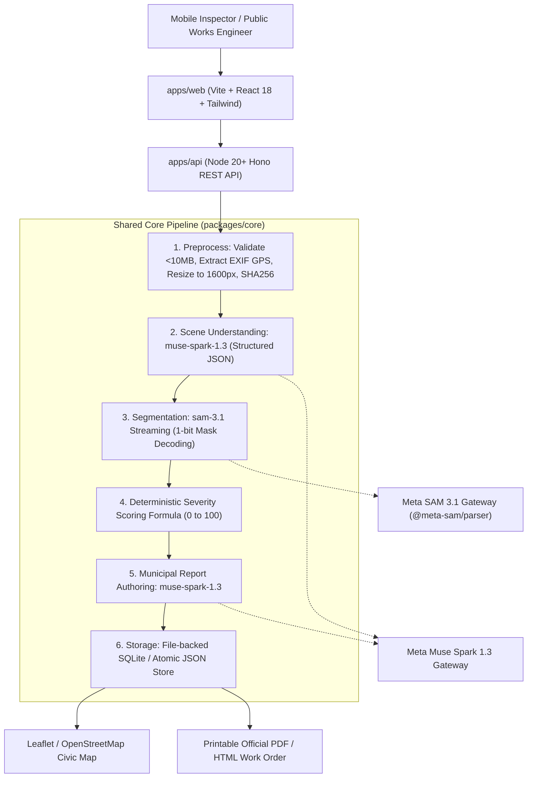

# Viaguard

> **Turn any phone photo of a street or a construction site into an actionable inspection report for city authorities.**

[](LICENSE)
[](https://www.typescriptlang.org/)
[](https://pnpm.io/)
[](https://dev.meta.ai/)

---

## 🏆 Built During the Hackathon

**Viaguard was created 100% from scratch during the Meta Global AI Developer Hackathon (October 27 – November 4, 2026)** under the **Indie Developer** track (**Theme: Build for Your World**). Every commit, package, interface, and test in this repository was authored during the official hackathon window.

---

## 💡 Overview

Municipal public works departments face backlogs of citizen complaints and slow inspection cycles. Inspectors take photos on smartphones, but manually categorizing damage, measuring pothole surface areas, and composing repair work orders can take days.

**Viaguard** bridges this gap:
1. **Road Damage Module (Primary)**: An inspector snaps a street photo. Viaguard automatically reads camera EXIF GPS tags, uses **Muse Spark** to classify road context and suggest damage concepts, streams segmentation with **SAM 3.1** via `@meta-sam/parser` to calculate sub-pixel relative damage areas, computes a deterministic hazard severity score (0–100), places color-coded pins on an interactive civic map, and generates a printable municipal work order.
2. **Construction Progress Module (Secondary)**: Upload a BEFORE and an AFTER photo of any job site. Viaguard segments matching structural elements (concrete walls, scaffolding, rebar, debris) across epochs, produces an exact volumetric delta table, and uses Muse Spark to author a comparative progress audit with safety alerts.

---

## 🤖 How Meta's Models Are Used

Viaguard depends strictly on Meta's models through the **Meta Model API** (`https://api.meta.ai/v1`) using the OpenAI SDK Responses API. Meta's models are never replaced or simulated in the core flow.

| Model ID | Role in Viaguard | Technical Implementation Details |
|---|---|---|
| **`sam-3.1`** | **Sub-Pixel Object Segmentation** | Called through the Responses API with `stream: true`. Receives one short noun phrase concept (e.g. `"pothole"`, `"crack"`, `"scaffolding"`). Requests 1-bit mask encoding (`metadata: { mask_encoding: "one_bit", include_confidence: "true" }`). Decoded with official `@meta-sam/parser` (`parseImageStream`, `recordsOfKind`, `decodeMaskToRaster`, and `decodeMaskToSVGPath`) to calculate exact active raster pixel area percentages and crisp vector SVG overlay paths. |
| **`muse-spark-1.3`** | **Scene Understanding & Reasoning** | Receives the street image with strict structured JSON schema (`response_format: { type: "json_object" }`) to identify road surface type, structural condition, and suggest target SAM concept prompts. |
| **`muse-spark-1.3`** | **Comparative Construction Diffing** | Compares BEFORE and AFTER site measurements, distinguishing physical structural progression from deterioration and safety risks. |
| **`muse-spark-1.3`** | **Municipal Report Authoring** | Synthesizes measured relative surface areas, confidence scores, and damage counts into actionable civic repair recommendations (cold patching, milling, crack sealing) and urgency tiers. |

---

## 🏗️ System Architecture



---

## 📐 Deterministic Severity Scoring Formula

Viaguard does **not** hallucinate severity numbers. Severity is calculated deterministically in `packages/core/src/scoring.ts` using verified measurements:

$$\text{RawScore} = (S_{\text{area}} + S_{\text{count}} + 5) \times \left(0.7 + 0.3 \times C_{\text{avg}}\right) \times \frac{W_{\max}}{1.2}$$

- **Area Factor ($S_{\text{area}}$)**: $\min(\sum \text{relativeAreaPercent} \times 4.0, 60)$ (up to 60 points). In civic road inspection, 15%+ frame coverage of potholes represents severe roadbed failure.
- **Count Factor ($S_{\text{count}}$)**: $\min(N_{\text{damage}} \times 7.0, 35)$ (up to 35 points).
- **Confidence Factor ($C_{\text{avg}}$)**: Average detection confidence $\in [0, 1]$.
- **Hazard Multiplier ($W_{\max}$)**: Maximum concept weight:
  - Pothole: $1.4$ (vehicle damage / structural void hazard)
  - Damaged road surface: $1.2$
  - Crack: $1.0$ (water intrusion risk)
  - Debris: $1.1$
  - Manhole cover: $0.1$ (*neutral reference object; does not artificially escalate road hazard score*)
- **Score Range**: Clamped to $[0, 100]$:
  - `0 - 24`: **Low** (routine cosmetic wear)
  - `25 - 54`: **Medium** (moderate cracking)
  - `55 - 79`: **High** (active pothole, asphalt breakdown)
  - `80 - 100`: **Critical** (deep hazardous void requiring emergency closure)

---

## 🔒 Privacy-by-Design Protection

Municipal street photos frequently capture pedestrians and vehicle license plates. Viaguard includes an integrated **Privacy Protection Module** (`applyPrivacyBlur`):
- SAM 3.1 segments `"person"` and `"license plate"`.
- A 25px Gaussian blur is composited directly over sensitive facial and license coordinates prior to image persistence.
- Enabled by default in the UI inspection controls.

---

## 🚀 Getting Started

### Prerequisites
- Node.js 20+ (Node 24 supported)
- [pnpm](https://pnpm.io/) (`corepack enable pnpm` or `npm install -g pnpm`)

### 1. Clone & Install
```bash
git clone https://github.com/TWFoxcrack/viaguard.git
cd viaguard
pnpm install
```

### 2. Configure Environment Variables
Copy `.env.example` to `.env`:
```bash
cp .env.example .env
```
Open `.env` and provide your Meta Model API key:
```env
MODEL_API_KEY=your_meta_model_api_key_here
PORT=3001
WEB_URL=http://localhost:5173
```
*(Obtain your key from [https://dev.meta.ai/](https://dev.meta.ai/))*

### 3. Verify Meta Model API Gateway
Run the live connectivity verification script:
```bash
pnpm check:meta
```
This tests:
1. Live structured scene reasoning with `muse-spark-1.3`
2. Live streaming segmentation and mask raster decoding with `sam-3.1`

### 4. Run Development Servers
```bash
pnpm dev
```
- **Web Client**: `http://localhost:5173`
- **Backend API**: `http://localhost:3001`

### 5. Run Unit & Integration Tests
```bash
pnpm test
```
Runs 21 Vitest tests validating severity scoring, area calculations, construction diffing, Zod schemas, privacy blur, and REST endpoints.

### 6. Run Headless CLI Inspection
```bash
pnpm analyze:sample apps/web/public/samples/road-sample-pothole.jpg
```

---

## 🛡️ Demo Resilience Mode

To safeguard against transient network issues or offline evaluation during hackathon judging:
- Bundled synthetic sample inspection photos are included in `apps/web/public/samples/`.
- If `DEMO_MODE=true` or offline, Viaguard replays verified pre-cached model outputs clearly marked with a `⚡ Pre-cached Response (Demo Mode)` badge. The default mode is always live.

---

## ⚠️ Limitations & Honesty Notes

- **Relative Measurements**: Area measurements represent percentages of the digital camera sensor frame ($A_{\text{damage}} / A_{\text{image}}$), not certified topographic square meters, unless a calibrated physical reference scale is placed in the scene.
- **Model Boundaries**: SAM 3.1 performs precise spatial localization (masks and bounding boxes); high-level semantic civil engineering reasoning and report generation are handled by Muse Spark.

---

## 📄 License

Viaguard is open-source software licensed under the [MIT License](LICENSE).
Third-party licenses and acknowledgments are documented in [THIRD_PARTY.md](THIRD_PARTY.md).
