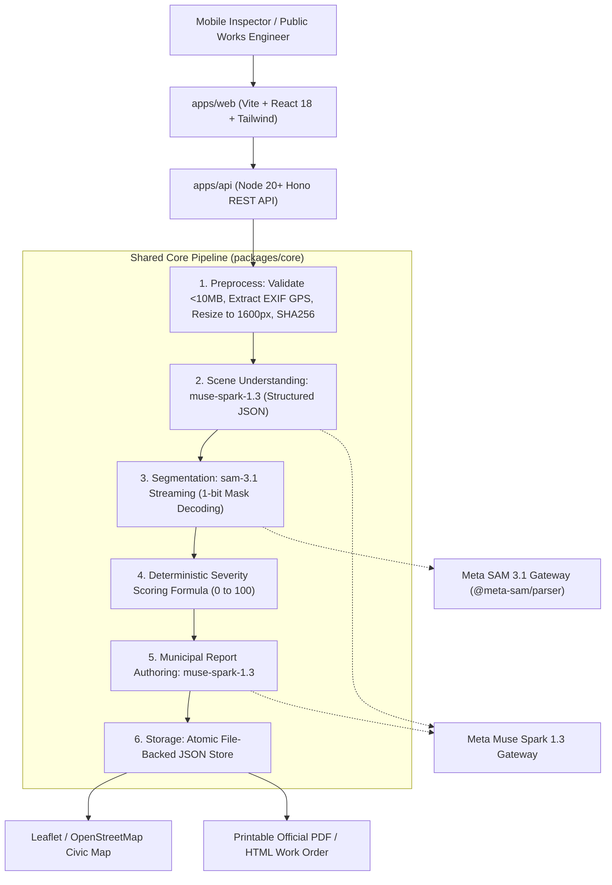

# Viaguard

> **Turn any phone photo of a street or a construction site into an actionable inspection report for city authorities.**

[](LICENSE)
[](https://www.typescriptlang.org/)
[](https://pnpm.io/)
[](https://dev.meta.ai/)

---

## 🏆 Built During the Hackathon

**Viaguard was created 100% from scratch during the Meta Global AI Developer Hackathon (October 27 – November 4, 2026)** under the **Indie Developer** track (**Theme: Build for Your World**). Every commit, package, interface, and test in this repository was authored during the official hackathon window.

- **Official Hackathon Submission Portal**: https://cerebralvalley.ai/e/meta-ai-developer-hackathon/hackathon/submit

---

## 💡 Overview

Municipal public works departments face backlogs of citizen complaints and slow inspection cycles. Inspectors take photos on smartphones, but manually categorizing damage, measuring pothole surface areas, and composing repair work orders can take days.

**Viaguard** bridges this gap:
1. **Road Damage Module (Primary)**: An inspector snaps a street photo. Viaguard automatically reads camera EXIF GPS tags, uses **Muse Spark** to classify road context and suggest damage concepts, streams segmentation with **SAM 3.1** via `@meta-sam/parser` to calculate sub-pixel relative damage areas, computes a deterministic hazard severity score (0–100), places color-coded pins on an interactive civic map, and generates a printable municipal work order.
2. **Construction Progress Module (Secondary)**: Upload a BEFORE and an AFTER photo of any job site. Viaguard segments matching structural elements (concrete walls, scaffolding, rebar, debris) across epochs, produces an exact volumetric delta table, and uses Muse Spark to author a comparative progress audit with safety alerts.

---

## 🤖 How Meta's Models Are Used

Viaguard depends strictly on Meta's models through the **Meta Model API** (`https://api.meta.ai/v1`) using the OpenAI SDK Responses API. Meta's models are never replaced or simulated in the core flow.

| Model ID | Role in Viaguard | Technical Implementation Details |
|---|---|---|
| **`sam-3.1`** | **Sub-Pixel Object Segmentation** | Called through the Responses API with `stream: true`. Receives one short noun phrase concept (e.g. `"pothole"`, `"crack"`, `"scaffolding"`). Requests 1-bit mask encoding (`metadata: { mask_encoding: "one_bit", include_confidence: "true" }`). Decoded with official `@meta-sam/parser` (`parseImageStream`, `recordsOfKind`, `decodeMaskToRaster`, and `decodeMaskToSVGPath`) to calculate exact active raster pixel area percentages and crisp vector SVG overlay paths. |
| **`muse-spark-1.3`** | **Scene Understanding & Reasoning** | Receives the street image with strict Responses API structured JSON schema (`text: { format: { type: "json_schema", strict: true } }`) to identify road surface type, structural condition, and suggest target SAM concept prompts. |
| **`muse-spark-1.3`** | **Comparative Construction Diffing** | Compares BEFORE and AFTER site measurements, distinguishing physical structural progression from deterioration and safety risks. |
| **`muse-spark-1.3`** | **Municipal Report Authoring** | Synthesizes measured relative surface areas, confidence scores, and damage counts into actionable civic repair recommendations (cold patching, milling, crack sealing) and urgency tiers. |

---

## 🏗️ System Architecture



---

## 🧹 SAM 3.1 Post-Processing & Filtering Constants (`packages/core/src/filtering.ts`)

To eliminate false-positive masks on plain asphalt or paint stripes, drop sub-pixel speckle noise, and prevent overlapping duplicate detections, `packages/core/src/filtering.ts` enforces four post-processing stages before severity scoring and report generation:

1. **Concept Sanitizing (`sanitizeConcept` / `sanitizeConcepts`)**:
   - Forces `muse-spark-1.3` (via structured schema + prompt + code enforcement) to emit **1-to-2-word plain nouns only** (e.g., `"pothole"`, `"crack"`, `"patch"`, `"manhole cover"`).
   - Rejects any concept longer than 2 words, any concept containing adjectives/modifiers (`"cracked"`, `"damaged"`, `"broken"`, `"worn"`), and paint/surface labels (`"road marking"`, `"road surface"`).
   - Road inspections **always** include `"pothole"` and `"crack"` alongside sanitized Muse Spark suggestions.
2. **Per-Concept Confidence Thresholds**:
   - `POTHOLE_MIN_CONFIDENCE = 0.5`: Discards `"pothole"` instances with SAM 3.1 confidence `< 0.5`.
   - `DEFAULT_MIN_CONFIDENCE = 0.6`: Discards all other concept instances with SAM 3.1 confidence `< 0.6`.
3. **Minimum Instance Size (`MIN_AREA_RATIO = 0.0015`)**:
   - `MIN_AREA_RATIO = 0.0015` (`0.15%` of total image pixel area): Discards tiny distant specks or single-cluster SAM artifacts whose mask covers `< 0.15%` of the frame (`filterFindingsByMinArea`), as masks that small cannot be reliably measured from a street-level camera photo.
4. **Cross-Instance Non-Maximum Suppression (`NMS_IOU_THRESHOLD = 0.5`)**:
   - Runs across **all** surviving instances regardless of concept label, computing pixel-level binary mask IoU (from `@meta-sam/parser` rasters) and bounding-box IoU. Whenever `IoU > 0.5`, only the highest-confidence instance is retained.

In the frontend overlay (`apps/web/src/components/MaskOverlayViewer.tsx`), numbered badges (`1, 2, 3...`) match the right-hand findings list, bounding boxes are optional (off by default), visible default badges are collision-avoided and capped at `MAX_VISIBLE_BADGES = 8` (prioritizing highest confidence), and the full label callout appears only on hover or selection.

---

## 📐 Deterministic Severity Scoring Formula & Constants (`packages/core/src/scoring.ts`)

Viaguard does **not** hallucinate severity numbers. Severity is calculated deterministically in `packages/core/src/scoring.ts` strictly from the **filtered, size-checked, NMS-deduplicated** findings, and every report exposes the full `severityBreakdown` (`area`, `largest`, `count`, `confidence`, `type weights`).

Each active damage instance $i$ contributes an effective weighted area:

$$e_i = \text{relativeAreaPercent}_i \times \text{confidence}_i \times w_i$$

$$\text{Score} = \text{clamp}\!\Big(\text{round}\big(S_{\text{total}} + S_{\text{largest}} + S_{\text{count}}\big),\; 0,\; 100\Big)$$

- **Total Damaged Area Term ($S_{\text{total}}$, dominant factor #1)**:
  $$S_{\text{total}} = \min\!\left(\text{MAX\_TOTAL\_AREA\_SCORE},\; \text{TOTAL\_AREA\_SCORE\_FACTOR} \times \sum_i e_i\right)$$
  - `TOTAL_AREA_SCORE_FACTOR = 4.5` (points per `1%` effective damaged frame area)
  - `MAX_TOTAL_AREA_SCORE = 50` (up to `50` points)
- **Largest Single Instance Area Term ($S_{\text{largest}}$, dominant factor #2)**:
  $$S_{\text{largest}} = \min\!\left(\text{MAX\_LARGEST\_INSTANCE\_SCORE},\; \text{LARGEST\_INSTANCE\_SCORE\_FACTOR} \times \max_i e_i\right)$$
  - `LARGEST_INSTANCE_SCORE_FACTOR = 5.0` (points per `1%` effective area of the single largest defect, ensuring one deep wheel-striking pothole outranks scattered micro-blemishes)
  - `MAX_LARGEST_INSTANCE_SCORE = 40` (up to `40` points)
- **Instance Count Bonus ($S_{\text{count}}$, capped minor term)**:
  $$S_{\text{count}} = \min\!\left(\text{MAX\_COUNT\_BONUS},\; \text{COUNT\_BONUS\_PER\_INSTANCE} \times \sum_i \text{confidence}_i\right)$$
  - `COUNT_BONUS_PER_INSTANCE = 1.25` (confidence-weighted points per defect)
  - `MAX_COUNT_BONUS = 10` (strictly capped at `+10` so fragmented tiny detections never dominate total area)
- **Concept Type Weights (`CONCEPT_WEIGHTS`)**:
  - `sinkhole`: `1.5`
  - `pothole`: `1.3` (structural pavement void / vehicle impact hazard)
  - `steel rebar` / `rebar`: `1.2`
  - `debris` / `rut` / `spall`: `1.1`
  - `crack`: `1.0` (water intrusion & freeze/thaw propagation)
  - `patch`: `0.7` (repaired surface wear)
  - `puddle`: `0.6` (standing drainage water)
  - `manhole cover`: `0` (neutral municipal utility fixture; excluded from damage scoring)
- **Severity Level Bands & Deterministic Urgency Mapping (`SEVERITY_URGENCY_MAP` in `packages/core/src/report-signals.ts`)**:
  Target repair urgency is derived **strictly in code** from `severityLevel` via `getUrgencyForSeverity(level)` and passed as a fixed policy input to Muse Spark (which writes the narrative around it and never invents its own timeframe):
  - `low` (`0 – 24`): **`within 30 days`**
  - `medium` (`25 – 54`): **`within 14 days`**
  - `high` (`55 – 79`): **`within 7 days`**
  - `critical` (`80 – 100`): **`immediate`**

### Separated Signals, Neutral Titles & Discrepancy Transparency (`packages/core/src/report-signals.ts`)
- **Two Clearly Separated Signals Everywhere (UI, Report Detail, Printable HTML/PDF, JSON)**:
  1. **`Measured severity (SAM)`**: Deterministic score (`0–100`) and level (`low` / `medium` / `high` / `critical`) computed strictly from discrete defects segmented by SAM 3.1.
  2. **`Visual condition (Muse Spark)`**: Overall scene condition (`good` / `fair` / `poor` / `critical`) plus a single concise sentence of visual explanation.
- **Neutral Report Titles (`buildNeutralReportTitle`)**: Report titles never state a condition or severity score (e.g., `"Road inspection report — 2026-10-30"` or `"Road inspection report — 37.7749, -122.4194"`).
- **Signal Mismatch Note (`SIGNAL_MISMATCH_NOTE`)**: Whenever `Measured severity (SAM)` and `Visual condition (Muse Spark)` differ by **2 or more ordinal levels** (for example `low` vs `poor`), Viaguard explicitly displays:
  > *"Measured severity counts only discrete defects detected by SAM. Diffuse surface deterioration may not be captured."*
- **Static Findings Limitations Line (`REPORT_LIMITATIONS_TEXT`)**: Displayed beneath every findings table/list:
  > *"Limitations: Detections cover discrete defects; areas are relative to the image frame."*

---

## 🔒 Privacy-by-Design Protection (ON by Default)

Municipal street photos frequently capture pedestrians and vehicle license plates. Viaguard runs its **Privacy Protection Module** (`applyPrivacyBlur`) **ON by default** in both the REST API and web UI:
- SAM 3.1 segments `"person"` and `"license plate"` (`PRIVACY_MIN_CONFIDENCE = 0.25`).
- Padded mosaic + Gaussian blur is composited directly over detected pedestrian and license plate regions and written to the stored upload image (`apps/api/uploads/...`) so both persisted and displayed images are anonymized.
- Inspected views and exported HTML/PDF work orders display a visible **`Privacy blur: on`** badge.

---

## 🚀 Getting Started

### Prerequisites
- Node.js 20+ (Node 24 supported)
- [pnpm](https://pnpm.io/) (`corepack enable pnpm` or `npm install -g pnpm`)

### 1. Clone & Install
```bash
git clone https://github.com/TWFoxcrack/viaguard.git
cd viaguard
pnpm install
```

### 2. Configure Environment Variables
Copy `.env.example` to `.env`:
```bash
cp .env.example .env
```
Open `.env` and provide your Meta Model API key:
```env
MODEL_API_KEY=your_meta_model_api_key_here
PORT=3001
WEB_URL=http://localhost:5173
```
*(Obtain your key from [https://dev.meta.ai/](https://dev.meta.ai/))*

### 3. Verify Meta Model API Gateway
Run the live connectivity verification script:
```bash
pnpm check:meta
```
This tests:
1. Live structured scene reasoning with `muse-spark-1.3`
2. Live streaming segmentation and mask raster decoding with `sam-3.1`

### 4. Run Development Servers
```bash
pnpm dev
```
- **Web Client**: `http://localhost:5173`
- **Backend API**: `http://localhost:3001`

### 5. Run Unit & Integration Tests
```bash
pnpm test
```
Runs 41 Vitest tests validating concept sanitizing, confidence filtering, minimum mask area (`MIN_AREA_RATIO`), cross-concept NMS, area-dominant severity scoring & breakdown, separated SAM vs. Muse Spark signals, neutral titles, deterministic urgency mapping, construction diffing, Zod schemas, privacy blur, opt-in Demo Mode honesty, and REST endpoints.

### 6. Run Headless CLI Inspection
```bash
pnpm analyze:sample apps/web/public/samples/road-sample-pothole.jpg
```

---

## 🛡️ Opt-In Demo Mode (Verified Real Cache Replay)

Demo Mode is strictly **opt-in** and never activates silently when `MODEL_API_KEY` is missing or when a live API request fails:
- **Default Mode (Live API)**: Every inspection calls `muse-spark-1.3` and `sam-3.1` live via `https://api.meta.ai/v1`. If `MODEL_API_KEY` is unset or an API error occurs, Viaguard surfaces a clear diagnostic error instead of switching modes.
- **Recording Real Demo Responses**: Once `MODEL_API_KEY` is configured in `.env`, record real Meta Model API responses into `data/cache/` with:
  ```bash
  pnpm record:demo apps/web/public/samples/road-sample-pothole.jpg
  pnpm record:demo apps/web/public/samples/road-sample-cracks.jpg
  pnpm record:demo apps/web/public/samples/construction-before-site.jpg apps/web/public/samples/construction-after-site.jpg
  ```
- **Replaying Cached Real Responses**: Only when a user explicitly enables Demo Mode (via the UI switch or `DEMO_MODE=true`), Viaguard replays verified real API responses from `data/cache/` and displays a persistent **"Replaying cached real responses"** banner.

---

## ⚠️ Limitations & Honesty Notes

- **Relative Measurements**: Area measurements represent percentages of the digital camera sensor frame ($A_{\text{damage}} / A_{\text{image}}$), not certified topographic square meters, unless a calibrated physical reference scale is placed in the scene.
- **Model Boundaries**: SAM 3.1 performs precise spatial localization (masks and bounding boxes); high-level semantic civil engineering reasoning and report generation are handled by Muse Spark.

---

## 📄 License & Credits

Viaguard is open-source software licensed under the [MIT License](LICENSE).
Third-party licenses and acknowledgments are documented in [THIRD_PARTY.md](THIRD_PARTY.md).

UI visual layer built with [React Bits](https://reactbits.dev) by David Haz.
