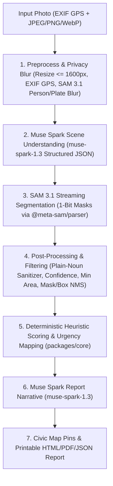

# Viaguard

> **Turn a phone photo of a street or a construction site into a structured inspection report for city teams.**

[](LICENSE)
[](https://www.typescriptlang.org/)
[](https://pnpm.io/)
[](https://dev.meta.ai/)

---

## 🏆 Built During the Hackathon

**Viaguard was created from scratch during the Meta Global AI Developer Hackathon (October 27 – November 4, 2026)** under the **Indie Developer** track (**Theme: Build for Your World**). Every commit, package, interface, and test in this repository was authored during the official hackathon window.

- **Official Hackathon Submission Portal**: https://cerebralvalley.ai/e/meta-ai-developer-hackathon/hackathon/submit

---

## 💡 Overview

Municipal public works teams often receive street and site photos from inspectors or residents, and manually reviewing images, estimating affected areas, and drafting repair notes can be slow and manual.

**Viaguard** helps structure that workflow across two modules sharing one core pipeline:
1. **Road Damage Module (Primary)**: Upload a street photo. Viaguard reads camera EXIF GPS tags when present, uses **Muse Spark** to classify road context and suggest plain-noun damage concepts, streams 1-bit mask segmentation with **SAM 3.1** via `@meta-sam/parser` to measure relative damaged frame areas, computes a deterministic heuristic severity score (`0–100`), places pins on an interactive civic map, and generates a printable inspection report.
2. **Construction Progress Module (Secondary)**: Upload a `BEFORE` and an `AFTER` photo of the same site. Viaguard segments target structural and hazard elements (concrete walls, scaffolding, rebar, cracks, debris) across both images, computes the **relative area change between BEFORE and AFTER**, and uses Muse Spark to write a comparative progress summary.

---

## 🤖 How Meta's Models Are Used

Viaguard depends directly on Meta's models through the **Meta Model API** (`https://api.meta.ai/v1`) using the OpenAI SDK Responses API. Meta's models are never simulated in Live API mode.

| Model ID | Role in Viaguard | Technical Implementation Details |
|---|---|---|
| **`sam-3.1`** | **Concept Mask Segmentation** | Called through the Responses API with `stream: true`. Receives one short plain-noun concept prompt (e.g., `"pothole"`, `"crack"`, `"scaffolding"`). Requests 1-bit mask encoding (`metadata: { mask_encoding: "one_bit", include_confidence: "true" }`). Decoded with official `@meta-sam/parser` (`parseImageStream`, `recordsOfKind`, `decodeMaskToRaster`, and `decodeMaskToSVGPath`) to compute relative active mask pixel area percentages within the image frame and vector SVG overlay paths. |
| **`muse-spark-1.3`** | **Scene Understanding & Reasoning** | Receives the image with Responses API structured JSON schema (`text: { format: { type: "json_schema", strict: true } }`) to identify surface/scene type, overall visual condition, and candidate SAM concept prompts. |
| **`muse-spark-1.3`** | **Comparative Construction Diffing** | Interprets the relative area change between `BEFORE` and `AFTER` alongside the `AFTER` image to summarize structural progression versus debris or crack accumulation. |
| **`muse-spark-1.3`** | **Inspection Report Narrative** | Synthesizes measured relative frame areas, confidence scores, defect counts, and the code-assigned heuristic urgency window into repair recommendations plus a one-sentence visual condition explanation. |

---

## 🏗️ System Architecture



---

## 🧹 SAM 3.1 Post-Processing & Filtering Constants (`packages/core/src/filtering.ts`)

To reduce false-positive masks on plain asphalt or paint stripes, discard tiny speckle noise, and suppress overlapping duplicate detections, `packages/core/src/filtering.ts` applies four post-processing stages before severity scoring and report generation:

1. **Concept Sanitizing (`sanitizeConcept` / `sanitizeConcepts`)**:
   - Constrains `muse-spark-1.3` (via structured schema, prompt, and code validation) to **1-to-2-word plain nouns only** (e.g., `"pothole"`, `"crack"`, `"patch"`, `"manhole cover"`).
   - Rejects concepts longer than 2 words, concepts containing adjectives/modifiers (`"cracked"`, `"damaged"`, `"broken"`, `"worn"`), and paint/surface labels (`"road marking"`, `"road surface"`).
   - Road inspections always include `"pothole"` and `"crack"` alongside sanitized Muse Spark suggestions.
2. **Per-Concept Confidence Thresholds**:
   - `POTHOLE_MIN_CONFIDENCE = 0.5`: Discards `"pothole"` instances with SAM 3.1 confidence `< 0.5`.
   - `DEFAULT_MIN_CONFIDENCE = 0.6`: Discards all other concept instances with SAM 3.1 confidence `< 0.6`.
3. **Minimum Instance Size (`MIN_AREA_RATIO = 0.0015`)**:
   - `MIN_AREA_RATIO = 0.0015` (`0.15%` of total image pixel area): Discards tiny distant specks or small SAM artifacts whose mask covers `< 0.15%` of the frame (`filterFindingsByMinArea`), as very small masks are unreliable from a handheld street photo.
4. **Cross-Instance Non-Maximum Suppression (`NMS_IOU_THRESHOLD = 0.5`)**:
   - Runs across surviving instances regardless of concept label, computing pixel-level binary mask IoU (from `@meta-sam/parser` rasters) and bounding-box IoU. Whenever `IoU > 0.5`, only the highest-confidence instance is retained.

In the frontend overlay (`apps/web/src/components/MaskOverlayViewer.tsx`), numbered badges (`1, 2, 3...`) match the right-hand findings list, bounding boxes are optional (off by default), visible default badges use collision-avoidance capped at `MAX_VISIBLE_BADGES = 8` (prioritizing highest confidence), and the full label callout appears on hover or selection.

---

## 📐 Deterministic Severity Formula & Heuristic Constants (`packages/core/src/scoring.ts`)

> **Important Note on Heuristics**: All formula coefficients, per-concept type weights (`CONCEPT_WEIGHTS`), severity band cutoffs, and repair urgency windows (`within 30 days`, `within 14 days`, `within 7 days`, `immediate`) are **configurable project heuristics** defined in `packages/core/src/scoring.ts` and `packages/core/src/report-signals.ts` — **not** civil-engineering or municipal regulatory standards.

Severity is computed deterministically in `packages/core/src/scoring.ts` from the filtered, size-checked, NMS-deduplicated findings, and every report exposes the full `severityBreakdown` (`area`, `largest`, `count`, `confidence`, `type weights`):

```text
effective_area[i] = relativeAreaPercent[i] * confidence[i] * typeWeight[i]

S_total   = min(MAX_TOTAL_AREA_SCORE,       TOTAL_AREA_SCORE_FACTOR       * sum(effective_area[i]))
S_largest = min(MAX_LARGEST_INSTANCE_SCORE, LARGEST_INSTANCE_SCORE_FACTOR * max(effective_area[i]))
S_count   = min(MAX_COUNT_BONUS,            COUNT_BONUS_PER_INSTANCE      * sum(confidence[i]))

Score     = clamp(round(S_total + S_largest + S_count), 0, 100)
```

```text
Configurable Scoring Constants (packages/core/src/scoring.ts):
  TOTAL_AREA_SCORE_FACTOR       = 4.5    (points per 1% weighted damaged frame area)
  MAX_TOTAL_AREA_SCORE          = 50     (maximum points from total damaged area)
  LARGEST_INSTANCE_SCORE_FACTOR = 5.0    (points per 1% weighted area of largest single defect)
  MAX_LARGEST_INSTANCE_SCORE    = 40     (maximum points from largest single defect)
  COUNT_BONUS_PER_INSTANCE      = 1.25   (confidence-weighted points per instance)
  MAX_COUNT_BONUS               = 10     (cap so multiple tiny detections do not dominate area)

Configurable Concept Type Weights (CONCEPT_WEIGHTS):
  sinkhole                      = 1.5
  pothole                       = 1.3
  steel rebar / rebar           = 1.2
  debris / rut / spall          = 1.1
  crack                         = 1.0
  patch                         = 0.7
  puddle                        = 0.6
  manhole cover, concrete wall,
  scaffolding, excavator, etc.  = 0.0    (neutral fixtures / structural progress elements;
                                          excluded from hazard scoring, tracked in construction diffs)

Configurable Severity Bands & Heuristic Urgency Windows (packages/core/src/report-signals.ts):
  low      (0 - 24)   -> "within 30 days"
  medium   (25 - 54)  -> "within 14 days"
  high     (55 - 79)  -> "within 7 days"
  critical (80 - 100) -> "immediate"
```

### Separated Signals, Neutral Titles & Discrepancy Transparency (`packages/core/src/report-signals.ts`)
- **Two Clearly Separated Signals Everywhere (UI, Report Detail, Printable HTML/PDF, JSON)**:
  1. **`Measured severity (SAM)`**: Deterministic heuristic score (`0–100`) and level (`low` / `medium` / `high` / `critical`) computed strictly from discrete defects segmented by SAM 3.1.
  2. **`Visual condition (Muse Spark)`**: Overall scene condition (`good` / `fair` / `poor` / `critical`) plus one concise sentence of visual explanation.
- **Neutral Report Titles (`buildNeutralReportTitle`)**: Report titles never state a condition or severity score (e.g., `"Road inspection report — 2026-10-30"` or `"Road inspection report — 37.7749, -122.4194"`).
- **Signal Mismatch Note (`SIGNAL_MISMATCH_NOTE`)**: Whenever `Measured severity (SAM)` and `Visual condition (Muse Spark)` differ by **2 or more ordinal levels** (for example `low` vs `poor`), Viaguard displays:
  > *"Measured severity counts only discrete defects detected by SAM. Diffuse surface deterioration may not be captured."*
- **Static Findings Limitations Line (`REPORT_LIMITATIONS_TEXT`)**: Displayed beneath every findings table/list:
  > *"Limitations: Detections cover discrete defects; areas are relative to the image frame."*

---

## 🔒 Privacy-by-Design Protection (ON by Default)

Street and job-site photos frequently capture pedestrians and vehicle license plates. Viaguard runs its **Privacy Protection Module** (`applyPrivacyBlur`) **ON by default** in both the REST API and web UI:
- SAM 3.1 segments `"person"` and `"license plate"` (`PRIVACY_MIN_CONFIDENCE = 0.25`).
- Padded pixel mosaic + Gaussian blur is composited over detected pedestrian and license plate regions and written to the stored upload image (`apps/api/uploads/...`) so persisted and displayed images are blurred.
- Inspected views and exported HTML/PDF reports display a visible **`Privacy blur: on`** badge.

---

## 🚀 Getting Started

### Prerequisites
- Node.js 20+ (Node 24 supported)
- [pnpm](https://pnpm.io/) (`corepack enable pnpm` or `npm install -g pnpm`)

### 1. Clone & Install
```bash
git clone https://github.com/Foxcrack/viaguard.git
cd viaguard
pnpm install
```
*(Running `pnpm install` automatically compiles the shared `@viaguard/core` workspace package via `postinstall`.)*

### 2. Configure Environment Variables
Copy `.env.example` to `.env`:
```bash
# macOS / Linux / Git Bash
cp .env.example .env

# Windows PowerShell
Copy-Item .env.example .env
```
Open `.env` and provide your Meta Model API key:
```env
MODEL_API_KEY=your_meta_model_api_key_here
PORT=3001
WEB_URL=http://localhost:5173
```
*(Obtain your key from [https://dev.meta.ai/](https://dev.meta.ai/))*

### 3. Verify Meta Model API Gateway
Run the live connectivity verification script:
```bash
pnpm check:meta
```
This tests:
1. Live structured scene reasoning with `muse-spark-1.3`
2. Live streaming segmentation and mask raster decoding with `sam-3.1`

### 4. Run Development Servers
```bash
pnpm dev
```
- **Web Client**: `http://localhost:5173`
- **Backend API**: `http://localhost:3001`

### 5. Run Unit & Integration Tests
```bash
pnpm test
```
Runs 41 Vitest tests validating concept sanitizing, confidence filtering, minimum mask area (`MIN_AREA_RATIO`), cross-concept NMS, area-dominant severity scoring & breakdown, separated SAM vs. Muse Spark signals, neutral titles, deterministic urgency mapping, construction diffing, Zod schemas, privacy blur, opt-in Demo Mode honesty, and REST endpoints.

### 6. Run Headless CLI Inspection
```bash
# Single-photo Road Damage inspection
pnpm analyze:sample apps/web/public/samples/road-sample-pothole.jpg

# Before & After Construction Progress comparative inspection
pnpm analyze:sample apps/web/public/samples/construction-before-site.jpg apps/web/public/samples/construction-after-site.jpg
```

---

## 🛡️ Opt-In Demo Mode (Local Replay Only — No Pre-Cached Responses Bundled)

**No pre-cached API responses are included in this repository** (`data/` is gitignored), and Demo Mode **never** activates silently when `MODEL_API_KEY` is missing or when a live API request fails:
- **Default Mode (Live API)**: Every inspection calls `muse-spark-1.3` and `sam-3.1` live via `https://api.meta.ai/v1`. If `MODEL_API_KEY` is unset or an API error occurs, Viaguard surfaces a clear diagnostic error instead of switching modes.
- **Recording Local Demo Responses (Optional)**: Once `MODEL_API_KEY` is configured in `.env`, you can optionally record real Meta Model API responses into your local `data/cache/` directory with:
  ```bash
  pnpm record:demo <road-image-path>
  pnpm record:demo <before-image-path> <after-image-path>
  ```
- **Replaying Locally Recorded Responses**: Only when you explicitly enable Demo Mode (via the UI switch or `DEMO_MODE=true`) after recording with `pnpm record:demo`, Viaguard replays those locally recorded responses from `data/cache/` and displays a persistent **"Replaying cached real responses"** banner. If no local cache exists for that image, Demo Mode returns an explicit error instructing you to record it first or switch back to Live API mode.

---

## 🧪 Validation Status

- **Road Damage Module**: Tested live end-to-end against the Meta Model API (`muse-spark-1.3` and `sam-3.1`) on real street photos, verifying concept sanitizing, confidence and minimum-area filtering, cross-concept NMS, privacy blurring on pedestrians and license plates, separated severity vs. visual condition signals, and report generation.
- **Construction Progress Module**: Works end-to-end against the live Meta Model API (`muse-spark-1.3` and `sam-3.1`), **but has so far only been tested on synthetic images and on programmatically edited pairs — NOT on real before/after field photos**.
- **Bundled Sample Images (`apps/web/public/samples/`)**: All four sample images (`road-sample-pothole.jpg`, `road-sample-cracks.jpg`, `construction-before-site.jpg`, and `construction-after-site.jpg`) are programmatically generated synthetic illustrations, not real camera photographs.
- **Results on author's own photos**: to be added.

---

## 🤝 Development Transparency

This project was built during the Meta Global AI Developer Hackathon (October 27 – November 4, 2026) with an AI coding agent (**Antigravity**) directed by the author, who reviewed, tested, and iterated on the implementation and outputs. At runtime, Meta's models (**SAM 3.1** and **Muse Spark** via the official Meta Model API) are the core of the application, performing all scene understanding, image segmentation, and report narrative generation.

---

## ⚠️ Limitations & Honesty Notes

- **Relative Frame-Area Measurements Only**: Area measurements represent the percentage of pixels within the 2D camera image frame (`damage_pixels / image_pixels`), not physical surface area in square meters or 3D volume, unless a calibrated reference scale is used. Construction comparisons measure the **relative area change between BEFORE and AFTER** from the camera viewpoint and are sensitive to framing/camera angle differences.
- **Heuristic Scoring & Urgency**: Severity weights, score caps, and urgency windows (`7` / `14` / `30` days / `immediate`) are configurable project heuristics, not engineering or municipal standards.
- **Model Boundaries**: SAM 3.1 localizes discrete visual concepts as 2D binary masks and bounding boxes (and can miss diffuse surface wear or partially occluded pedestrians/plates); scene reasoning and report prose are generated by Muse Spark.

---

## 📄 License & Credits

Viaguard is open-source software licensed under the [MIT License](LICENSE).
Third-party licenses and acknowledgments are documented in [THIRD_PARTY.md](THIRD_PARTY.md).

UI visual layer built with [React Bits](https://reactbits.dev) by David Haz.
